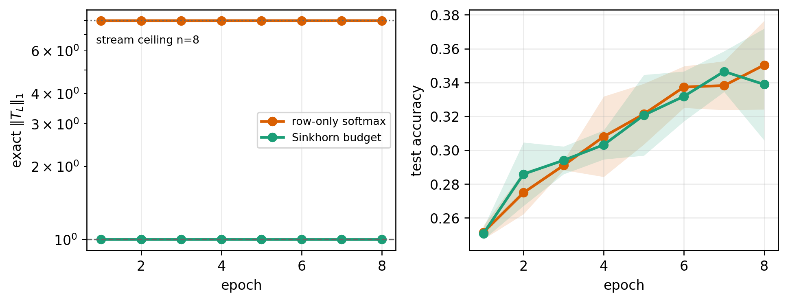
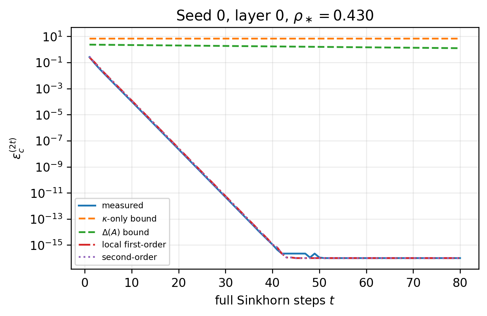

# Finite-Step Sinkhorn Certificates

Code and saved diagnostics for **Finite-Step Sinkhorn Certificates for Nonnegative
Stream-Mixing Products**, by Maksim Kosmakov, accepted in *Transactions on Machine
Learning Research* (2026).

[Paper and reviews](https://openreview.net/forum?id=NyEeOl6Gn7)

The code measures how finite Sinkhorn normalization controls the backward gain of
a stack of nonnegative stream mixers. The reported experiments use CIFAR-10:
a matched small-transformer run, a four-policy controller ablation, and calibration
and local-predictor diagnostics.

## Main results

For nonnegative, row-stochastic mixers, the paper bounds the backward gain of
the depth-wise product using the measured column defects:

```math
T_L = H^{(L)}\cdots H^{(1)}, \qquad
\lVert T_L\rVert_1 \le \min\Bigl(\prod_{\ell=1}^L(1+\varepsilon_c^{(\ell)}),\ n\Bigr).
```

Finite-step Sinkhorn estimates turn the number of normalization steps and the
logit dynamic range into a sufficient column tolerance. The adaptive controller
allocates that tolerance across layers under a shared product budget. These
bounds concern the mixer pathway; controlling the full network also requires
bounds on the nonlinear branches.

### Backward gain in a trained transformer

The matched CIFAR-10 run uses 24 layers, eight streams, 5,000 training images,
2,000 test images, and eight epochs. Both policies use matched initialization and
minibatches within each of three seeds. At the final epoch:

| Mixer policy | Exact backward gain | Product certificate | Test accuracy |
| --- | ---: | ---: | ---: |
| Row-only softmax | 7.9814 +/- 0.0036 | (4.459 +/- 0.001) x 10^21 | 35.0 +/- 2.6% |
| Sinkhorn budget | 1.000015 +/- 0.000002 | 1.0063 +/- 0.0016 | 33.9 +/- 3.3% |



The row-only gain nearly reaches the structural ceiling of eight, while Sinkhorn
keeps it near one. Both policies train without nonfinite updates; this run
demonstrates gain control, without an observed optimization failure in the
row-only model. Values are mean +/- standard deviation over seeds 0, 1, and 2.
The post-hoc Dobrushin certificate on the saved Sinkhorn stacks is
1.000079 +/- 0.000009, much tighter than the structural ceiling.

[Transformer logs](relevance-demo/logs/) |
[Saved mixers](relevance-demo/mixers/) |
[Certificate comparison](tables/certificate_comparison_table.tex)

### Cost of stopping policies

The depth-128, eight-stream CIFAR-10 stress setting compares four policies over
three seeds and five epochs, with a step cap of 80:

| Policy | Avg. steps | Time/epoch (s) | Product certificate |
| --- | ---: | ---: | ---: |
| Fixed cap | 80.00 +/- 0.00 | 758.0 +/- 6.1 | 1.0004 +/- 0.0003 |
| Uniform tolerance | 16.36 +/- 0.71 | 325.4 +/- 17.6 | 1.0521 +/- 0.0012 |
| Adaptive budget | 15.86 +/- 0.73 | 309.6 +/- 19.1 | 1.0659 +/- 0.0001 |
| Certificate-aware penalty | 15.80 +/- 0.72 | 570.2 +/- 34.2 | 1.0656 +/- 0.0000 |

Adaptive stopping uses about 3.1% fewer steps and 4.8% less epoch time than uniform
stopping in these runs. The exact gains are near one for all four policies, with
mean test accuracies between 58.1% and 58.4%. Uniform, adaptive, and penalty
policies share a mean cap-failure rate of 0.26%; the stopping-rule guarantee is
conditional on reaching each allocated tolerance. The adaptive and penalty
policies target the product budget 1.066075. The penalty takes substantially more
training time in this implementation.

Step counts and certificates summarize the final epoch; time summarizes all
recorded epochs and seeds. [Full summaries and uncertainties](paper-extra-experiments/logs/focused_ablation_summary.csv)
and [raw epoch logs](paper-extra-experiments/logs/focused_ablation_epoch_logs.csv)
are included.

### Certificates and local predictors



For this representative trained matrix, the rigorous Hilbert bounds are
conservative, while the local first- and second-order predictors track the
observed decay toward the numerical floor. Its local spectral rate is
approximately 0.430. The predictors explain convergence near the Sinkhorn limit;
they do not enter the deterministic budget certificate.
[Saved predictor curves](paper-extra-experiments/logs/local_predictor_curves.csv)
cover seeds 0 and 1 and layers 0, 64, and 127.

## Install

Use Python 3.10 or later. Install PyTorch appropriate for your CPU or CUDA device,
then install the remaining dependencies:

```bash
python -m pip install -r requirements.txt
```

## Check the saved results on CPU

No dataset or training is needed for these commands:

```bash
python scripts/dobrushin_diagnostic.py --roots relevance-demo/mixers \
  --csv regenerated/dobrushin_diagnostic.csv \
  --tex regenerated/dobrushin_diagnostic_table.tex \
  --comparison-tex regenerated/certificate_comparison_table.tex
python scripts/budget_sensitivity_diagnostic.py \
  --csv regenerated/budget_sensitivity.csv \
  --tex regenerated/budget_sensitivity_table.tex
python scripts/regenerate_saved_diagnostics.py --out-dir regenerated
```

The first command audits the six saved final mixer stacks: two policies, three
seeds, 24 layers, and eight streams. The budget sweep re-normalizes the saved
row-softmax stacks under different budgets. Its CPU timings will vary by machine.
The last command recreates the figures and summaries from the CSV logs and checks
the finite-step lookup values. Checked-in outputs retain the measurements used in
the published paper.

## Run the experiments

See [RUN_GPU_COMMANDS.md](RUN_GPU_COMMANDS.md) for the exact training commands,
a real-data CPU smoke test, and the settings for each reported experiment.
The focused controller comparison uses seeds `0,1,2` for five epochs; the matched
transformer run uses the same three seeds, 5,000 training images, 2,000 test images,
and eight epochs. The transformer diagnostic uses a prescribed mixer initialization
to expose the gain difference between the two normalization policies.

Kaggle notebooks are in `notebooks/`. They contain the helper modules needed for
execution. Enable a GPU and add the
[cifar10-python dataset](https://www.kaggle.com/datasets/pankrzysiu/cifar10-python).
The dataset is not included in this repository. On Kaggle it is mounted at
`/kaggle/input/cifar10-python`; locally, point the scripts to the extracted
`cifar-10-batches-py` directory or its parent, as documented in the commands.

## Files

- `code/`: training, normalization, and plotting code. The extra-experiment runner
  imports `code/adaptive_budget_ablation_kaggle.py`.
- `scripts/`: post-hoc certificate audits and regeneration from saved results.
- `relevance-demo/`: transformer configuration, epoch logs, final mixer stacks,
  and figures.
- `paper-extra-experiments/`: focused ablation logs, calibration grid, and local
  predictor curves. The saved local-predictor curves cover seeds 0 and 1.
- `results-stressed-cap80/`: the cap-80 stress-run logs and audit figures.
- `results/`, `tables/`: post-hoc certificate and budget-sensitivity outputs.
- `manuscript/`: camera-ready LaTeX, PDF, styles, and required figure/table files.

## AI assistance

The author used OpenAI Codex for assistance with code development and debugging.
The author takes responsibility for all content.

## Citation and license

Use the citation in `CITATION.cff`, or cite the paper through its OpenReview page.
The code is released under the MIT License. The manuscript is distributed under
CC BY 4.0; third-party style files retain their own notices.
